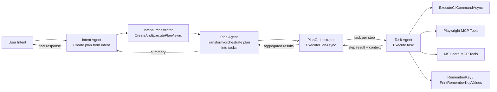
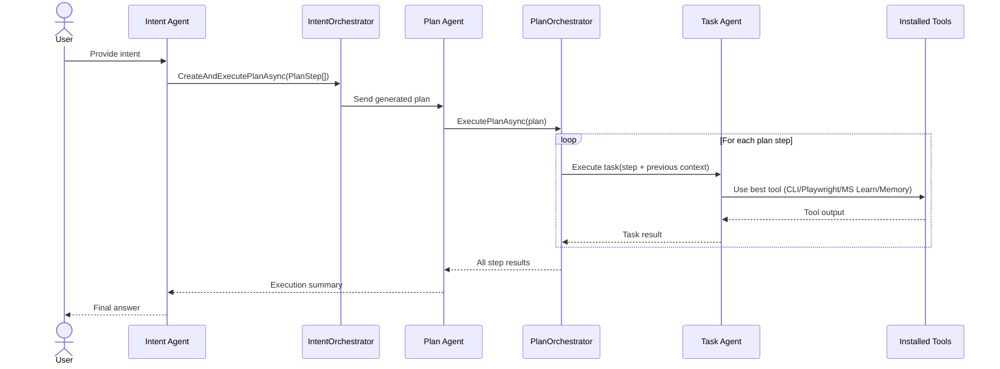

# SimpleClawSession - 3-Agent Workflow Diagram

This diagram summarizes how `SimpleClawSession` coordinates three agents:

1. **Intent Agent** takes the user intent and creates a plan.
2. **Plan Agent** takes that plan and breaks/orchestrates it into executable tasks.
3. **Task Agent** executes each task using installed tools (CLI, Playwright MCP, MS Learn MCP, memory helpers).

## High-level flow

## Sequence view

## Agent responsibilities

- **Intent Agent**
  - Interprets user intent.
  - Produces a structured plan (`PlanStep[]`).
  - Delegates execution via `CreateAndExecutePlanAsync`.

- **Plan Agent**
  - Receives the plan.
  - Orchestrates task creation/execution through `ExecutePlanAsync`.
  - Collects and summarizes step outputs.

- **Task Agent**
  - Executes one task at a time.
  - Selects and invokes installed tools.
  - Returns concrete outputs/errors for each step.
